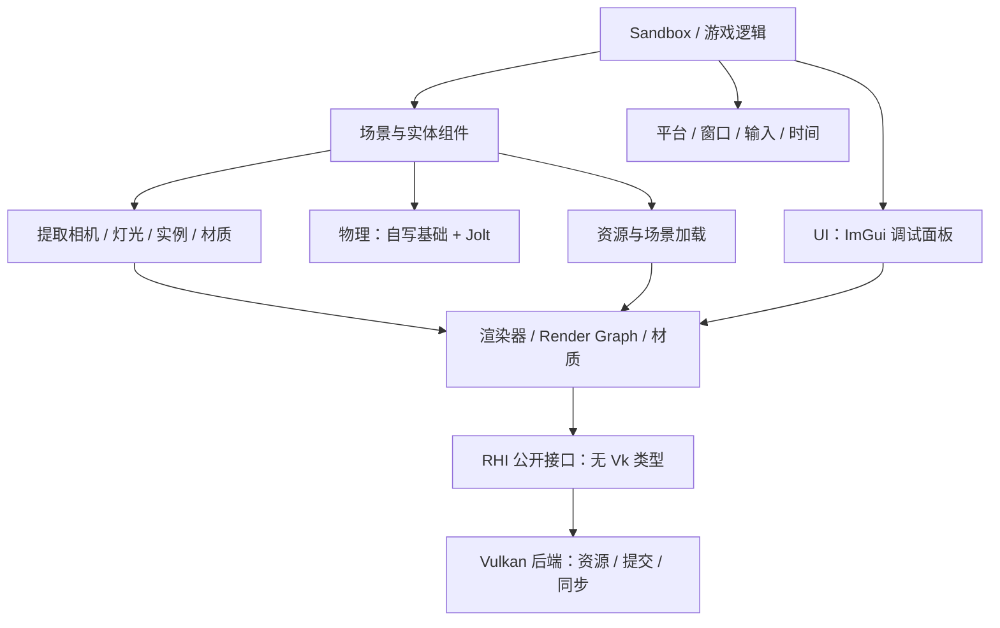

# 架构与技术选择

本文是设计方向，不是已实现能力清单。当前只有 `vle_core` 和 `vle_sandbox`，之后由实际课程需求逐步增加模块。

2026-11-21 课程顺序调整为 Vulkan 优先：从无窗口的 Instance、验证层和设备枚举开始，SDL3 随 Surface 引入，输入随相机引入；日志、错误处理和对象所有权随 Vulkan 对象展开。模块表保留长期边界，不要求先实现完整 Core/Platform 再调用 Vulkan。

开发方式采用编辑器无关的命令行 CMake + Ninja：VS Code 或 Vim/Neovim 负责编辑，Windows/Linux 使用各自工具链重新构建。公共源码优先标准 C++ 与跨平台库；系统差异集中在 Platform 和工具链配置中。环境步骤见 [开发环境](DEVELOPMENT.md)。

## 模块与数据流

箭头表示调用或数据交接方向。图中是未来职责划分；不要求立刻为每个方框创建基类、库或线程。

| 模块 | 负责的内容 | 边界 |
| --- | --- | --- |
| Core | 日志、时间、错误、句柄等基础能力 | 不依赖窗口、场景或 GPU |
| Platform | 窗口、事件、输入、平台路径 | 屏蔽操作系统差异，不替场景执行逻辑 |
| Scene | 实体、组件、层级、场景加载/切换/卸载 | 使用资源句柄，不持有 Vulkan 句柄 |
| Assets | 导入、缓存、引用、稳定标识、烘焙数据 | 区分文件身份、运行时句柄与 GPU 实例 |
| Renderer | 提取后的渲染数据、材质、灯光、pass、render graph | 只通过 RHI 访问 GPU；不通过隐式全局状态访问整个世界 |
| RHI | 后端无关的设备、资源句柄、命令列表、pipeline 描述、能力查询（R1–R5 引入） | 公开头文件不包含 `vulkan.h`、不暴露 `Vk*` 类型；当前只有 Vulkan 后端 |
| Vulkan 后端 | 设备、队列、内存、描述符、pipeline、barrier、同步和延迟销毁 | RHI 的私有实现；明确对象所有权与 GPU 完成条件。L04–L10 期间尚无 RHI，可直接使用 |
| UI | Dear ImGui 布局与用户自写的 Vulkan 渲染后端（R 阶段后改为基于 RHI）；调试面板 | 只读或通过明确接口修改场景/渲染参数 |
| Physics | 自写固定步长、碰撞检测与冲量求解；Jolt 承担复杂刚体；GPU compute 布料/粒子 | 不持有渲染对象；用明确数据和事件与场景交互 |
| 扩展：Animation | 扩展清单中的骨骼动画与蒙皮 | 同上 |
| Sandbox / Tools | 教学入口、玩法、调试工具 | 组合引擎能力，不反向成为引擎依赖 |

场景先用简单的实体 ID、代际句柄和组件存储理解 ECS，父子层级作为独立关系处理。随性能需求演进数据布局；不在开始阶段追求通用 ECS 框架。

## 一帧的演进方向

第一版是单线程主循环：读取事件 → 更新状态 → 渲染 → 呈现。接入物理后使用固定步长 accumulator，限制异常大的帧间隔和单帧追赶次数；渲染使用插值状态减少抖动。

在物理课程中明确变换写入权：动态刚体由物理更新位置；角色控制器向运动学接口提交目标；扩展中的动画骨骼姿态与物体根变换分别管理。随后更新世界变换，提取渲染数据。不要允许两个系统在同一阶段无约束地覆盖同一变换。

Vulkan 初期优先使用简单队列拓扑。先掌握 command buffer、提交、fence、semaphore、image layout、pipeline stage 和 access mask，再引入多帧并行、timeline semaphore 或异步 compute。

“当前帧槽位”和“当前交换链图像索引”不是同一概念：资源复用取决于各自完成条件。特别是提交完成与呈现完成的约束需分别处理；交换链重建也要覆盖最小化、零尺寸和退出流程。

## 渲染基线与可选能力

Windows/Linux 暂定 Vulkan 1.3 基线，使用 dynamic rendering 与 synchronization2。这里的 1.3 是项目的兼容范围选择；已安装更新 SDK 不意味着必须要求更高的设备版本。Khronos 明确区分 [instance、device 与 headers 的版本](https://docs.vulkan.org/guide/latest/versions.html)。

| 路径 | 运行条件 | 不满足时的行为 |
| --- | --- | --- |
| 基础光栅化 | 基线版本、所需 feature、surface/present、格式和设备限制全部满足 | 输出具体缺失项，结束渲染初始化；平台/CPU 课程仍可独立运行 |
| GPU 剔除与间接绘制 | compute 与实际使用的 indirect 功能、limits 等通过查询 | 保留 CPU 剔除与直接绘制；需要时使用保守固定计数路径 |
| Meshlet 数据组织 | 离线生成局部顶点/三角形和包围信息 | 普通 vertex/index buffer 也可消费簇数据 |
| Mesh shader | `VK_EXT_mesh_shader` 与所需 feature/limits；task shader 单独检查 | 使用普通索引绘制路径 |
| Ray query | acceleration structure、ray query 及其完整依赖/features | 使用光栅阴影等基础效果 |
| Ray tracing pipeline | acceleration structure、ray tracing pipeline 及其依赖；SBT 对齐等限制满足 | 保持光栅路径；若 ray query 单独可用，可继续使用其效果 |

扩展名出现在 SDK 头文件中不代表运行设备支持，支持也不代表已经启用。创建设备前需 [查询 properties、extensions、features、limits 与 formats](https://docs.vulkan.org/guide/latest/querying_extensions_features.html)。各能力依赖以接入时的规范为准，表格不是完整的设备创建清单。

[Ray query 和 ray tracing pipeline](https://docs.vulkan.org/guide/latest/extensions/ray_tracing.html) 是不同的接口能力。本项目先用 query 把光追嵌入现有渲染，再学习独立 pipeline 和 SBT；path tracing 作为小场景实验，去噪和时间累积随后接入。

macOS 需要单独验证 Vulkan-on-Metal 实现，不能只从操作系统名称推断能力。截至 2026-11-14 查阅的 [MoltenVK 官方说明](https://github.com/KhronosGroup/MoltenVK/blob/main/README.md) 已针对 Apple Silicon 推荐 KosmicKrisp，并对 Intel Mac 保留 MoltenVK 建议。因此在 A 阶段根据目标机器和 SDK 选择实现、核对 portability 与版本要求，接入时重新核验；当前没有 macOS 实测结论。

## 依赖的引入时机

第 0 课没有第三方源码依赖。以下是拟定方案；每次接入再固定精确版本/提交、校验、许可证与构建选项。

| 方案 | 引入阶段 | 教学用途 |
| --- | --- | --- |
| [SDL3](https://wiki.libsdl.org/SDL3/README-cmake) | L04.2；输入在 L09 扩展 | 为 Vulkan Surface 提供最小窗口与事件；接入时固定版本与许可 |
| Vulkan SDK / GLSL / glslc | L04.1 接入 API 与验证层；L06 接入 shader 编译 | 学习显式对象与同步；构建修改随对应功能引入 |
| [VMA](https://github.com/GPUOpen-LibrariesAndSDKs/VulkanMemoryAllocator) | L07（先自写最简分配器） | 理解内存类型、绑定和 staging 后，接入成熟分配器 |
| [GLM](https://github.com/g-truc/glm) | B 阶段 | 数学计算；明确项目坐标与深度约定 |
| [stb_image](https://github.com/nothings/stb) | L08 | 图像解码；上传与布局转换由用户实现 |
| [Dear ImGui](https://github.com/ocornut/imgui) | U1 | 只使用核心布局；Vulkan 渲染后端由用户自写，不使用 `imgui_impl_vulkan` |
| [cgltf](https://github.com/jkuhlmann/cgltf) | E 阶段 | 解析 glTF；自行实现到引擎 mesh/material/scene 数据的转换 |
| [Jolt Physics](https://github.com/jrouwe/JoltPhysics) | L24 | 复杂刚体堆叠；基础碰撞检测与冲量求解先由用户自写 |
| [meshoptimizer](https://github.com/zeux/meshoptimizer) | 扩展 L36 | 构建和优化 meshlet |
| [miniaudio](https://github.com/mackron/miniaudio) | 暂缓 | 音频不在当前计划内 |

不使用 vk-bootstrap、Vulkan-Hpp RAII、`imgui_impl_vulkan`、nvpro `nvvk` 等会替用户完成 Vulkan 学习内容的辅助库。

SDL3 负责窗口与输入。序列化格式在 L14 选择，当前不提前增加依赖。

依赖管理优先使用 CMake FetchContent 配合固定提交，或固定归档与内容哈希，并支持预下载源码目录供离线构建。系统提供的 SDK/编译器记录版本，不混入源码依赖。Shader 生成和后续资源烘焙作为构建步骤声明输入、输出和依赖。

## 资源、材质与几何

外部模型、纹理、HDRI、动画和音频由助手按课程需要获取，保存具体来源、许可与版本信息；引擎内的导入和资源管线仍由用户实现。候选来源与登记方式见 [资产记录](ASSETS.md)。

资源从“源文件 → 导入数据 → 运行时资源 → GPU 资源”逐步分层。场景持有稳定引用；运行时句柄带代际信息；GPU 对象延迟释放到使用它的工作完成。后续烘焙缓存的键包含源数据、导入设置和格式版本。

材质先建立共享定义与参数实例，约束 CPU/shader 两侧的参数布局、纹理语义、缺省值和 pipeline 变体。L08 先用普通 descriptor set 理解绑定模型；R4 在 RHI 中改为 bindless（descriptor indexing），L15 的材质表建立在其上。第一条 PBR 路径使用 forward，之后根据测量选择是否引入 deferred 或 clustered lighting。

这里的 **mesh clustering** 指几何簇/meshlet，**clustered lighting** 指光源按空间单元分组，两者独立。Meshlet 尺寸根据设备 limits 和实际测量选择；层次 LOD 需要误差与边界处理；遮挡剔除需保守性和关闭开关；完整流送系统留给后续扩展。

## 验证策略

CPU 纯逻辑使用有意义的测试覆盖层级变换、句柄失效、保存/加载、动画边界采样。GPU 路径结合 validation、同步验证、调试视图和实际截图/抓帧；性能记录固定场景、相机、分辨率、硬件及构建配置。

构建自动化从有可运行项目时逐步接入，GPU 运行需要真实设备或明确标记的软件实现。自动化矩阵分开显示“编译”“CPU 测试”“GPU 基础路径”“可选高级路径”，不把其中一种通过扩展成所有平台通过。
