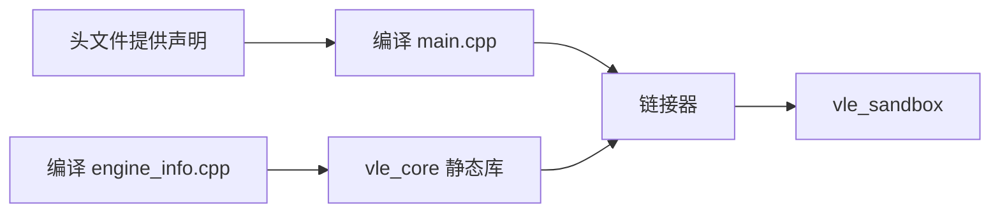

# 第 0 课：用命令行建立 C++ 工程

本课目标：你亲自编写一个静态库和调用它的程序，通过 CMake + Ninja 构建，在 VS Code 或 Vim 中编辑。先学会表达源码和依赖的关系，后续再把窗口、Vulkan 和其他系统加入同一套构建流程。

预计整课 3–5 小时。当前先做 L00.1：环境检查与最小工程；完成后再做 L00.2 的预设整理、依赖故障实验和自检。时间用于规划，不作为掌握标准。

初始化时助手生成的根目录骨架仅作参考。以下练习由你亲自创建，助手提供关键提示并审查，不替你写入课程代码。

当前入口（2026-11-14）：环境为 **Ubuntu 24.04.5 LTS / x86_64 / zsh**。用户已反馈编译运行且输出为空。最新审查确认 include 路径和 main 已补齐，练习可以编译链接，但 `engine_name()` 仍只有 TODO、没有返回值。先修正此问题并验证名称输出，再进行下文 L00.2。下文命令适用于当前 zsh，也适用于 Bash。

## L00.1：先理解工具关系

```text
你在 VS Code / Vim 中编辑 C++ 与 CMakeLists.txt
                 ↓
CMake 读取 target 和依赖，生成 build.ninja
                 ↓
Ninja 按依赖顺序调用编译器与链接器
                 ↓
MSVC / GCC / Clang 工具链生成本平台程序
```

编辑器负责修改文件，CMake 描述并生成构建关系，Ninja 执行构建，编译器与链接器生成程序。切换编辑器不会改变工程的编译规则；切换平台则要重新选择工具链、配置并构建。

Windows 当前可以直接使用已有 MSVC 命令行工具链，无需打开 Visual Studio IDE。Linux 使用 GCC 或 Clang，公共源代码与 CMake 描述继续复用。

## 第一步：确认工具

本课只需要 C++20 编译器、CMake 3.25+ 和 Ninja。当前 Linux 环境已完成检查，无需重复安装。可在终端复查：

```bash
cmake --version
ninja --version
c++ --version
command -v cmake ninja c++
```

本次实测：CMake 4.4.2、Ninja 1.11.1、GCC 13.3.0；另有 Clang/clangd 18.1.3、GDB 15.1。当前 CMake 实际选择 `/usr/bin/c++`（GCC）。clangd 可给编辑器提供语言服务，不要求同时把构建编译器改为 Clang。

Vulkan 工具、头文件和 validation layer 也已发现，但本课没有 Vulkan 调用。详细环境记录与 Windows 历史配置见 [开发环境说明](../DEVELOPMENT.md)。

跨平台只复用源码与构建描述；CMake 缓存、目标文件和程序必须在本平台重新生成。本课使用独立的 `build/lesson00-linux-debug`，不复用旧 Windows 构建目录。

## 第二步：完成已有的四文件练习

你的独立练习已经采用以下结构，继续编辑这些文件即可：

```text
practice/
  CMakeLists.txt
  include/vle/engine_info.hpp
  src/engine_info.cpp
  src/main.cpp
```

这是你实际采用的 L00 练习目录；完成审查后，由你把学到的结构应用到主工程，L01 起在主工程继续演进，避免长期维护两套引擎。第一份 `practice/CMakeLists.txt` 已按你的明确请求由助手补全并添加注释，三个 C++ 文件仍由你实现；之后修改构建配置时继续练习这些语法。

你需要实现：

1. 头文件声明 `vle::engine_name()`，返回 `std::string_view`。
2. 在单独的 `.cpp` 中定义它，返回指向静态字符串字面量的视图。
3. `main.cpp` 通过头文件调用这个函数，将名称输出到终端，然后正常退出。
4. CMake 声明 C++ 项目，创建 `vle_core` 静态库与 `vle_sandbox` 可执行 target，使后者链接前者，并要求 C++20。

2026-11-14 只读审查与构建结果：

| 文件 | 当前状态 | 你接下来要做的事 |
| --- | --- | --- |
| `practice/CMakeLists.txt` | 已有带注释的参考配置；Linux 配置成功 | 理解两个 target 和三条依赖关系 |
| `practice/include/vle/engine_info.hpp` | 已包含 `<string_view>`，函数声明正确 | 保留接口，理解它只声明、不提供函数体 |
| `practice/src/engine_info.cpp` | include 已正确；函数体只有 TODO，没有 return | 返回指向名称字面量的视图，消除 `-Wreturn-type` 警告 |
| `practice/src/main.cpp` | 已包含接口并调用、输出、返回 0 | 函数修正后验证输出内容 |

此前构建的首个错误是 `engine_info.hpp: No such file or directory`，发生在源码预处理阶段，现已修正。编译命令已有 `-I.../practice/include`，实际头文件在 `include/vle/`，可以包含：

```cpp
#include <vle/engine_info.hpp>
```

可以把查找关系理解为 `搜索根目录 practice/include` + `vle/engine_info.hpp`。仅把双引号换成尖括号不会补出缺少的 `vle/`。不要包含 `.cpp` 来绕过库的编译与链接关系。

最新 review 在新目录 `build/lesson00-linux-review` 配置、编译和链接完成，但 GCC 报告：

```text
warning: no return statement in function returning non-void [-Wreturn-type]
```

这是当前必须先修正的问题。`engine_name()` 返回 `std::string_view`，执行到函数末尾却没有返回值会产生未定义行为，并不会自动构造一个空视图。用户反馈的“空输出”不满足名称输出要求，也不能用来推断该错误每次都会输出空白。编译链接通过、程序能退出和行为正确需要分别验证。[C++ return 规则](https://eel.is/c++draft/stmt.return#4)

修正方向：在函数体内写一条返回名称字面量的语句，例如局部提示 `return "IceShell";`；由用户写入并保存，然后使用自己的练习构建目录重新编译运行。此次助手未运行已知存在未定义行为的版本。

## 核心代码提示

接口可以从以下声明开始；头文件的必要 include 和命名空间周边由你组织：

```cpp
namespace vle {
    [[nodiscard]] std::string_view engine_name() noexcept;
}
```

实现中需要注意 `string_view` 不拥有字符串内存。字符串字面量的生命周期适合本例；不要返回指向局部 `std::string` 数据的视图。

定义的局部提示如下，由你放进实现文件的 `namespace vle`，并补上返回值：

```cpp
std::string_view engine_name() noexcept
{
    // TODO：返回指向你选定名称的字符串字面量的视图。
}
```

`engine_name()` 没有输入，输出的是非拥有的字符视图；字面量具有静态存储期，无需调用方释放。本例不需要动态分配、单例或复杂引擎类。TODO 未完成时不要运行这段代码。

`main.cpp` 的算法步骤：包含引擎公开头文件和 `<iostream>` → 进入 `main` → 调用接口 → 输出名称和换行 → 返回 0。核心调用提示：

```cpp
const auto name = vle::engine_name();
// TODO：将 name 和换行写入 std::cout。
```

在你用 `add_library` 和 `add_executable` 创建 target 后，三条关键关系如下：

```cmake
target_compile_features(vle_core PUBLIC cxx_std_20)
target_include_directories(vle_core PUBLIC "${CMAKE_CURRENT_SOURCE_DIR}/include")
target_link_libraries(vle_sandbox PRIVATE vle_core)
```

第一条声明库的 C++ 标准要求并传给使用者；第二条让库自身及使用者都能找到公开头文件；第三条声明程序使用库，使所需使用条件传入程序，并让库参与链接。`PRIVATE` 表示这条依赖不作为程序的对外使用接口传播。

这里的 `target` 是 CMake 管理的构建目标：`vle_core` 产出静态库，`vle_sandbox` 产出程序。库的 `PUBLIC` 条件会被程序消费，即使程序用 `PRIVATE` 链接它；这个 `PRIVATE` 不会阻止程序接收库的公开条件。[头文件条件的作用域](https://cmake.org/cmake/help/latest/command/target_include_directories.html)、[链接与使用条件传递](https://cmake.org/cmake/help/latest/command/target_link_libraries.html)

第一份完整 CMake 参考见 [practice/CMakeLists.txt](../../practice/CMakeLists.txt)。阅读时依次确认 `cmake_minimum_required`、`project`、`add_library`、`add_executable` 和三条 target 关系各自负责什么。练习暂不设置自定义可执行输出目录，也不添加平台原生 API；保持问题规模足够小。

## 第三步：从项目根目录构建

补齐源码后，在当前 Linux 的 zsh/Bash 中执行：

```sh
cd /home/withmatthew/workspace/IceShell
cmake -S practice -B build/lesson00-linux-debug -G Ninja -DCMAKE_BUILD_TYPE=Debug -DCMAKE_EXPORT_COMPILE_COMMANDS=ON
cmake --build build/lesson00-linux-debug
./build/lesson00-linux-debug/vle_sandbox
echo $?
```

逐条执行，上一条成功后再执行下一条。Linux 运行文件没有 `.exe` 后缀。这组路径对应单目录练习；根目录参考工程的程序位于 `build/linux-debug/bin/vle_sandbox`，两者不要混用。

`-S` 指向源码，`-B` 指向生成文件，`-G Ninja` 选择构建方式。这里的 Ninja 是单配置生成器，所以 Debug 在配置命令中选择。

预期结果：终端输出你选定的引擎名称，程序退出码为 0；构建目录内生成 `build.ninja` 和 `compile_commands.json`。名称不必与参考程序一致。

例如名称选为 `IceShell`，最后两条命令应分别输出 `IceShell` 和 `0`。静态库位于 `build/lesson00-linux-debug/libvle_core.a`。

目前已生成 `build.ninja` 和 `compile_commands.json`；它们证明配置与生成成功，不证明源码编译、链接或运行成功。编译数据库记录每个源文件的实际编译参数，供 clangd 等工具读取。[CMake 编译数据库说明](https://cmake.org/cmake/help/latest/variable/CMAKE_EXPORT_COMPILE_COMMANDS.html)

需要定位错误或观察编译参数时，可用：

```sh
cmake --build build/lesson00-linux-debug --verbose
```

## 第四步：理解头文件与链接



`#include` 让编译器看到声明，库提供函数的定义。能够找到头文件和能够链接到实现是两个独立条件。

在 Linux 上，两个 `.cpp` 分别编译成 `.o`；`engine_info.cpp.o` 被归档为 `libvle_core.a`，链接器用程序的目标文件和库生成 `vle_sandbox`。静态库归档并不要求整个程序的符号已经齐全，程序链接才会检查被调用函数是否有匹配定义。

| 阶段 | 关注什么 | 本课可观察的例子 |
| --- | --- | --- |
| CMake 配置与生成 | 编译器、target、依赖和生成规则 | 当前已成功；产出 Ninja 规则和编译数据库 |
| 预处理与编译 | 头文件可见、声明和语法正确；查看诊断 | include 已修正；当前编译成功但有缺少 return 的警告 |
| 链接 | 被使用的符号有匹配定义 | 当前已有函数定义，链接成功；移除整个定义的实验预计触发 `undefined reference` |
| 运行 | 程序实际行为、退出码 | 用户反馈为空；缺少 return 导致未定义行为，待修正后验证名称输出 |

完成后自检：

1. 你能说明 CMake、Ninja、编译器和编辑器各自做什么吗？
2. 为什么程序不必手动再配置一遍引擎的 include 路径？
3. 如果声明可见、库成功生成，但其中缺少 `engine_name` 的定义，错误会在哪个阶段出现？
4. 为什么返回字符串字面量的 `string_view` 安全，返回局部 `std::string` 的视图不安全？
5. 换到 Linux 后，为什么需要重新生成构建目录，而不必重写这份公共 C++ 接口？

把你的实现、运行结果以及一个不确定点交给助手审查；你也可以直接说明练习所在路径，让助手只读检查。无需一次猜对所有配置细节，核心环节会提供代码提示。

## L00.2：完成首次运行后再做

本段解决两个问题：如何保存可复现的构建配置，以及如何根据构建阶段定位故障。预计 30–60 分钟，按实际理解情况调整。前置条件是 L00.1 输出名称、退出码为 0，且缺少 return 的警告已消失。

### 任务 A：把命令整理成预设

由你创建 `practice/CMakePresets.json`。预设保存配置参数，target 与源文件关系仍由 `CMakeLists.txt` 表达。configure preset 用来生成构建系统，build preset 指向一个 configure preset 以选择要构建的目录。[CMake 3.25 预设说明](https://cmake.org/cmake/help/v3.25/manual/cmake-presets.7.html)

关键字段提示如下，由你组织成完整 JSON：

| 位置 | 字段 / 值 |
| --- | --- |
| 根对象 | `version: 6`，与项目 CMake 3.25 最低要求兼容 |
| `configurePresets` 中的一个对象 | `name: "lesson00-debug"`、`generator: "Ninja"` |
| 同一配置预设 | `binaryDir: "${sourceDir}/../build/lesson00-linux-debug"` |
| 同一配置预设的 `cacheVariables` | `CMAKE_BUILD_TYPE: "Debug"`、`CMAKE_EXPORT_COMPILE_COMMANDS: "ON"` |
| `buildPresets` 中的一个对象 | `name: "lesson00-debug"`、`configurePreset: "lesson00-debug"` |

`${sourceDir}` 在这里是 `practice/`。不要写入本机绝对路径；JSON 属性名需带双引号，不支持普通注释。根目录的现有预设可作为语法参考，但对应的是参考工程。

创建后从练习目录运行：

```sh
cd /home/withmatthew/workspace/IceShell/practice
cmake --list-presets
cmake --preset lesson00-debug
cmake --build --preset lesson00-debug
../build/lesson00-linux-debug/vle_sandbox
echo $?
```

验收：预设可列出、配置构建成功、输出与此前一致；可以解释 configure preset 和 build preset 的分工。

### 任务 B：观察增量构建

只修改 `engine_info.cpp` 返回的名称字面量，保留头文件和 main 不变。从 `practice/` 执行：

```sh
cmake --build --preset lesson00-debug --verbose
../build/lesson00-linux-debug/vle_sandbox
```

预期重新编译 `engine_info.cpp`、重新归档库、重新链接程序；`main.cpp` 没变，通常不需要重新编译。记录实际输出，解释“程序要重新链接”与“main 要重新编译”的区别。文件不变时再构建一次，通常会看到 `ninja: no work to do.`。

### 任务 C：制造并恢复链接错误

先预测错误阶段，再在 `engine_info.cpp` 临时注释掉 **整个 `engine_name()` 定义（签名和函数体）**。保留 `.cpp` 文件、头文件声明、main 中的调用以及原有 CMake 关系。不要只删掉 return，否则会回到本次的未定义行为问题。

执行同一条构建命令，预期库可以归档、程序链接报 `undefined reference`。解释“声明仍在，为什么链接还失败”，然后恢复定义，重新构建运行，确认名称输出与退出码恢复正常。

可选拓展：临时移除 `target_link_libraries` 的关系。注意这可能先导致传递的 include 路径消失；如要专门观察链接错误，实验时单独保留头文件搜索路径。每次只改变一个因素，结束后恢复原有配置。

完成审查后，由你把理解后的构建与代码组织应用到主工程，L01 起在主工程继续演进。

每次故障实验只改一个因素。L00 的验收是用户亲自完成构建、能解释依赖传递、能定位并恢复一次故障；助手先前的参考工程构建不计作这一学习证据。

学习记录分别核对：① 你完成源码并亲自运行；② 你解释声明→定义→链接→调用的数据流及依赖传递；③ 你完成名称变体或故障诊断并恢复。当前先修正 L00.1 的返回值；L00.2 已安排但尚未执行，不自动记为完成。

## 下一课

L01 创建 SDL3 窗口并处理事件与退出。这里会继续由你实现代码；助手在 SDL 初始化、窗口创建、事件轮询和销毁顺序处提供关键 API 提示。L00 和 L01 都不需要下载模型、纹理或音频。
