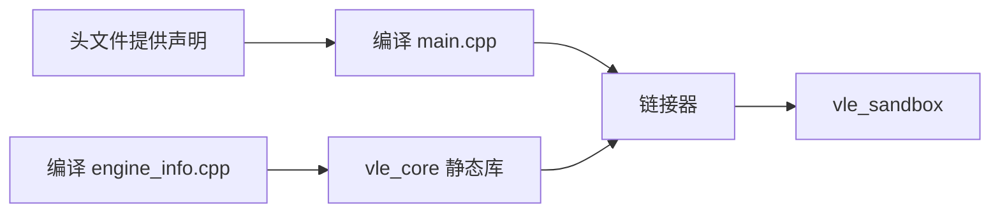

# 第 0 课：用命令行建立 C++ 工程

本课目标：你亲自编写一个静态库和调用它的程序，通过 CMake + Ninja 构建，在 VS Code 或 Vim 中编辑。先学会表达源码和依赖的关系，后续再把窗口、Vulkan 和其他系统加入同一套构建流程。

预计整课 3–5 小时。当前先做 L00.1：环境检查与最小工程；完成后再做 L00.2 的预设整理、依赖故障实验和自检。时间用于规划，不作为掌握标准。

初始化时助手生成的根目录骨架仅作参考。以下练习由你亲自创建，助手提供关键提示并审查，不替你写入课程代码。

## L00.1：先理解工具关系

```text
你在 VS Code / Vim 中编辑 C++ 与 CMakeLists.txt
                 ↓
CMake 读取 target 和依赖，生成 build.ninja
                 ↓
Ninja 按依赖顺序调用编译器与链接器
                 ↓
MSVC / GCC / Clang 工具链生成本平台程序
```

编辑器负责修改文件，CMake 描述并生成构建关系，Ninja 执行构建，编译器与链接器生成程序。切换编辑器不会改变工程的编译规则；切换平台则要重新选择工具链、配置并构建。

Windows 当前可以直接使用已有 MSVC 命令行工具链，无需打开 Visual Studio IDE。Linux 使用 GCC 或 Clang，公共源代码与 CMake 描述继续复用。

## 第一步：确认工具

先按 [开发环境说明](../DEVELOPMENT.md) 一次性配置 Windows 系统环境变量，再完全重启终端及其宿主。此后普通 Git Bash 和 PowerShell 都直接继承工具链环境，无需分别配置启动脚本。Git Bash 中检查：

```bash
cmake --version
ninja --version
command -v cmake ninja cl
```

如果使用 PowerShell，则在重新打开的 PowerShell 中检查：

```powershell
cmake --version
ninja --version
Get-Command cl
```

`Get-Command` 不能直接在 Bash 执行；Bash 使用 `command -v` 查找命令。Linux/macOS 可用 `c++ --version` 检查编译器。目前是本机 Windows 课程，不要求同时安装其他平台环境。

如果查不到编译器或 Ninja，先处理终端环境；不要把机器上的绝对工具路径填进共享 CMakeLists。助手在当前会话已确认工具存在，但 Ninja 配置曾停在编译器探测阶段，完整构建仍需验证。如果本机终端也停住，保留完整输出与构建目录供定位，不跳过编译器检查。

## 第二步：你创建四个文件

为区分已有参考与自己的实现，在项目内手动创建这个独立小工程：

```text
practice/
  CMakeLists.txt
  include/vle/engine_info.hpp
  src/engine_info.cpp
  src/main.cpp
```

这是你实际采用的 L00 练习目录；完成审查后，由你把学到的结构应用到主工程，L01 起在主工程继续演进，避免长期维护两套引擎。第一份 `practice/CMakeLists.txt` 已按你的明确请求由助手补全并添加注释，三个 C++ 文件仍由你实现；之后修改构建配置时继续练习这些语法。

你需要实现：

1. 头文件声明 `vle::engine_name()`，返回 `std::string_view`。
2. 在单独的 `.cpp` 中定义它，返回指向静态字符串字面量的视图。
3. `main.cpp` 通过头文件调用这个函数，将名称输出到终端，然后正常退出。
4. CMake 声明 C++ 项目，创建 `vle_core` 静态库与 `vle_sandbox` 可执行 target，使后者链接前者，并要求 C++20。

## 核心代码提示

接口可以从以下声明开始；头文件的必要 include 和命名空间周边由你组织：

```cpp
namespace vle {
    [[nodiscard]] std::string_view engine_name() noexcept;
}
```

实现中需要注意 `string_view` 不拥有字符串内存。字符串字面量的生命周期适合本例；不要返回指向局部 `std::string` 数据的视图。

在你用 `add_library` 和 `add_executable` 创建 target 后，三条关键关系如下：

```cmake
target_compile_features(vle_core PUBLIC cxx_std_20)
target_include_directories(vle_core PUBLIC "${CMAKE_CURRENT_SOURCE_DIR}/include")
target_link_libraries(vle_sandbox PRIVATE vle_core)
```

第一条声明库的 C++ 标准要求并传给使用者；第二条让库自身及使用者都能找到公开头文件；第三条声明程序使用库，使所需使用条件传入程序，并让库参与链接。`PRIVATE` 表示这条依赖不作为程序的对外使用接口传播。

第一份完整 CMake 参考见 [practice/CMakeLists.txt](../../practice/CMakeLists.txt)。阅读时依次确认 `cmake_minimum_required`、`project`、`add_library`、`add_executable` 和三条 target 关系各自负责什么。练习暂不设置自定义可执行输出目录，也不添加平台原生 API；保持问题规模足够小。

## 第三步：从项目根目录构建

下面假定你当前位于 `D:/Code-dx12`，而练习文件在 `practice/`：

```sh
cmake -S practice -B build/lesson00-debug -G Ninja -DCMAKE_BUILD_TYPE=Debug -DCMAKE_EXPORT_COMPILE_COMMANDS=ON
cmake --build build/lesson00-debug
```

你当前的 Windows Git Bash 执行：

```bash
./build/lesson00-debug/vle_sandbox.exe
```

PowerShell 对应执行：

```powershell
.\build\lesson00-debug\vle_sandbox.exe
```

Linux/macOS 对应执行 `./build/lesson00-debug/vle_sandbox`。这组路径对应上面的单目录练习；根目录参考工程另有 `bin/` 输出目录，两者不要混用。

`-S` 指向源码，`-B` 指向生成文件，`-G Ninja` 选择构建方式。这里的 Ninja 是单配置生成器，所以 Debug 在配置命令中选择。

预期结果：终端输出你选定的引擎名称，程序退出码为 0；构建目录内生成 `build.ninja` 和 `compile_commands.json`。名称不必与参考程序一致。

## 第四步：理解头文件与链接



`#include` 让编译器看到声明，库提供函数的定义。能够找到头文件和能够链接到实现是两个独立条件。

完成后自检：

1. 你能说明 CMake、Ninja、编译器和编辑器各自做什么吗？
2. 为什么程序不必手动再配置一遍引擎的 include 路径？
3. 如果声明可见、库成功生成，但其中缺少 `engine_name` 的定义，错误会在哪个阶段出现？

把你的实现、运行结果以及一个不确定点交给助手审查；你也可以直接说明练习所在路径，让助手只读检查。无需一次猜对所有配置细节，核心环节会提供代码提示。

## L00.2：完成首次运行后再做

1. 为自己的构建流程添加 Ninja 预设；用预设表达相同的 source/build、Debug 和编译数据库选项，不加入本机绝对路径。
2. 临时移除链接关系进行一次故障实验。注意这可能先导致传递的 include 路径消失；如要专门观察链接错误，实验时单独保留头文件搜索路径。解释错误发生阶段后，恢复原本的 target 关系。
3. 临时注释 `engine_info.cpp` 中 `engine_name` 的定义，保留源文件本身和头文件声明，观察库仍可编译而链接时找不到定义的错误；恢复并再次成功构建。
4. 修改名称并增量构建，观察重编译和重链接范围。
5. 根据审查结果，把自己理解后的构建和代码组织应用到主工程；由用户执行变更。

每次故障实验只改一个因素。L00 的验收是用户亲自完成构建、能解释依赖传递、能定位并恢复一次故障；助手先前的参考工程构建不计作这一学习证据。

## 下一课

L01 创建 SDL3 窗口并处理事件与退出。这里会继续由你实现代码；助手在 SDL 初始化、窗口创建、事件轮询和销毁顺序处提供关键 API 提示。L00 和 L01 都不需要下载模型、纹理或音频。
